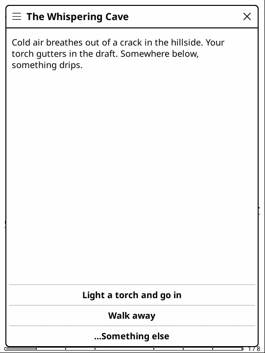
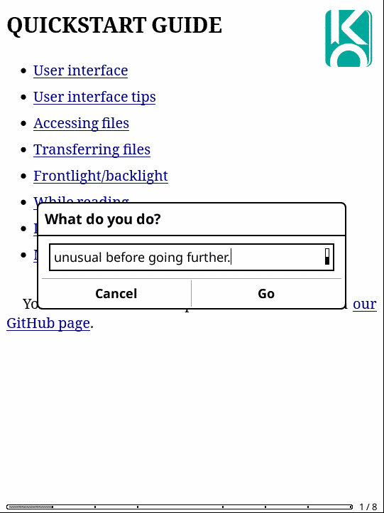
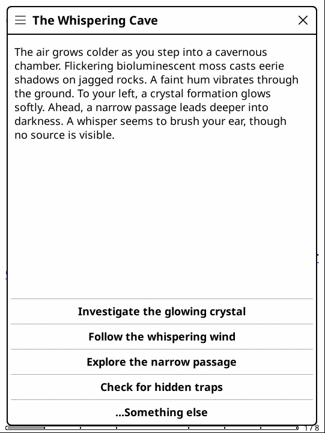

# inkRPG

**A single-player tabletop RPG for your e-reader, with an AI dungeon master that steps in when you go off-script.**

inkRPG is a [KOReader](https://github.com/koreader/koreader) plugin: it runs on jailbroken Kindles, Kobos, PocketBooks and Android readers, right next to your books. Adventures are hand-authored scene graphs, so they play fully offline. When none of the offered choices fits, pick **"…Something else"**, type what your character does, and an AI model narrates the outcome and keeps the story going from there.

<p align="center">
  
  
  
</p>

## Why

E-ink is a great surface for interactive fiction: short paragraphs, no notifications, a battery that lasts for weeks. Existing KOReader plugins each cover half of this idea. [frotz.koplugin](https://github.com/kbarni/frotz.koplugin) plays classic interactive fiction, and [assistant.koplugin](https://github.com/omer-faruq/assistant.koplugin) talks to LLMs. inkRPG combines the two: an authored adventure you can always finish offline, plus an AI dungeon master on demand.

## How it works

```
 game pack (plain Lua data)          engine (inkrpg.koplugin)                   AI provider (optional)
 ───────────────────────────         ────────────────────────────────           ─────────────────────────
 manifest.lua  ── persona, stats ──▶ turn loop · choices · save/resume
 scenes.lua    ── scene graph    ──▶ on_enter hooks mutate stats/flags
                                     "…Something else" ── context + action ──▶  OpenAI-compatible endpoint
                                     apply state_changes ◀── strict JSON ───────  { narration, choices,
                                     (hp, flags, items)                             state_changes }
```

- **The engine knows nothing about any specific adventure.** It discovers game packs in `games/`, renders the current scene and its choices, and saves after every step.
- **Game packs are data, not code.** A pack is a manifest (title, DM persona, starting stats) plus a scene graph made of Lua table literals.
- **The AI never touches game state directly.** The model must answer with one JSON object holding the narration, 2–4 new choices and a `state_changes` block (`hp_delta`, flags, items to add or remove). The engine validates it and applies the changes itself, clamping HP. If the model wraps the JSON in prose or a code fence, the engine extracts it. If the provider is unreachable, you get an error message and stay on the authored path instead of crashing.

## Features

- A playable, hand-authored demo adventure: **The Whispering Cave**.
- Save and resume per game, including the middle of an AI-improvised scene.
- In-app AI settings screen with:
  - provider presets: OpenAI, local **Ollama**, DeepSeek, Groq, OpenRouter, Custom;
  - model, masked API key and a **Test connection** button.

  Keys are stored in KOReader's own settings on the device, never in the plugin folder.
- Works with any OpenAI-compatible chat-completions endpoint, including a free local model.
- A dice and skill-check module, ready for packs that need it.

## Install

1. Install KOReader on your device ([instructions](https://github.com/koreader/koreader/wiki)).
2. Copy the `inkrpg.koplugin/` folder into KOReader's `plugins/` folder (over USB, for example).
3. Restart KOReader, then open **Tools → More tools → inkRPG → Play → The Whispering Cave**.

To enable the AI dungeon master:
1. Open **Tools → More tools → inkRPG → AI provider settings**.
2. Pick a preset and set the model and API key. For local Ollama, any non-empty placeholder key such as `ollama` works.
3. Press **Test connection**.

## Write your own adventure

Create a folder in `inkrpg.koplugin/games/` with two files.

`manifest.lua`:

```lua
return {
    title = "The Whispering Cave",
    dm_persona = [[You are a terse, atmospheric dungeon master. Keep replies under 120 words.]],
    starting_stats = { hp = 10, max_hp = 10, torches = 2 },
    start_scene = "cave_mouth",
}
```

`scenes.lua`:

```lua
return {
    cave_mouth = {
        text = "Cold air breathes out of a crack in the hillside...",
        choices = {
            { label = "Light a torch and go in", next = "entrance_hall" },
            { label = "Walk away", next = "ending_walk_away" },
        },
    },
    entrance_hall = {
        on_enter = function(stats) stats.torches = math.max(0, stats.torches - 1) end,
        text = "The passage opens into a hall lined with old, dry bones...",
        choices = { --[[ ... ]] },
    },
    ending_walk_away = {
        is_ending = true,
        text = "Some mysteries aren't worth the climb. You turn back to the light. THE END.",
        choices = {},
    },
}
```

Every scene that isn't an ending gets a **"…Something else"** button automatically. The DM persona from the manifest becomes the AI's system prompt, and the character's stats, inventory and flags are sent as context.

## Development

**Unit tests (no KOReader needed).** 63 tests run the real plugin Lua inside Python through [lupa](https://github.com/scoder/lupa), with KOReader's UI modules stubbed. They cover:
- dice;
- the game loader;
- save state and settings;
- the AI provider, with canned model replies;
- the play-screen state machine.

```bash
pip install -r tests/requirements.txt
pytest tests
```

**End-to-end in real KOReader.** `emulator/` builds the actual KOReader desktop emulator in Docker, runs it under Xvfb and drives it with `xdotool`, taking a screenshot after every tap. The screenshots above come from it.

The first build compiles KOReader and takes 20–40 minutes. After that the plugin folder is bind-mounted, so changes don't need a rebuild.

```bash
cd emulator
docker compose build
docker compose run --rm inkrpg-emulator   # screenshots land in emulator/screenshots/
```

Design notes and the phased plan are in [PLAN.md](PLAN.md). The full build log is in [docs/DEVLOG.md](docs/DEVLOG.md).

## Status

| Area | State |
|---|---|
| Engine, scene graph, save/resume | ✅ verified end to end in the KOReader emulator |
| AI settings screen | ✅ verified in the emulator |
| Structured AI turns (`requestStructured`) | ✅ verified in the emulator against a live local model (`qwen3:8b` via Ollama), plus unit tests with canned replies |
| Native Claude and Gemini APIs | ⏳ not started (OpenAI-compatible endpoints only) |
| Ollama preset without a placeholder key | ⏳ small UX fix pending |
| More game packs | ⏳ planned |

## License

[AGPL-3.0](LICENSE), the same license as KOReader.
